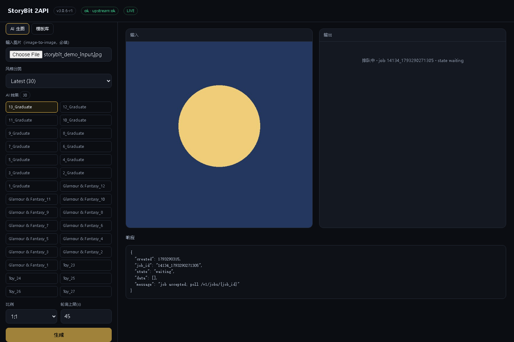
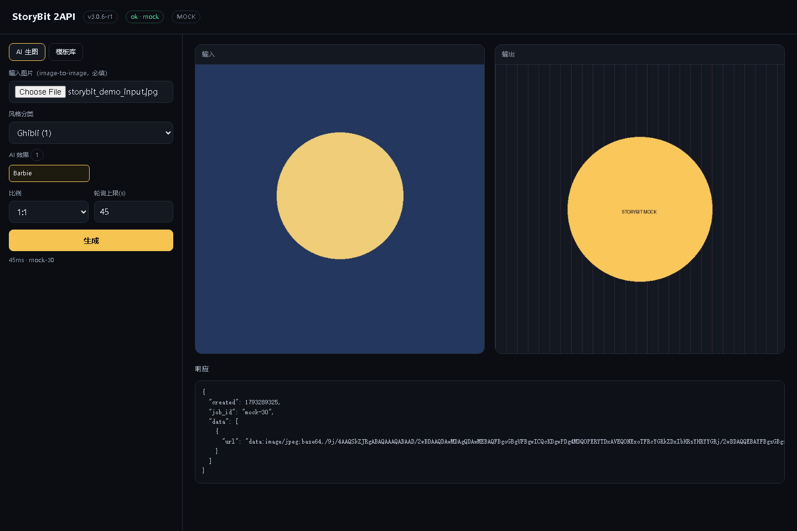

# StoryBit 2API (v3.0.6 r1)

把 `StoryBit v3.0.6`（`storybit.story.maker.animated.storymaker`）的私有协议包成
**OpenAI 兼容图像网关** + 模板/AI 效果目录 REST，可直接作为 new-api 渠道。

- 逆向报告（协议/加密/端点全表/证据）：[`docs/REVERSE-REPORT.md`](docs/REVERSE-REPORT.md)
- new-api 对接（字段级 + 排错表）：[`docs/NEW-API-INTEGRATION.md`](docs/NEW-API-INTEGRATION.md)

## 一句话结论

协议 **100% 打通**（`{"data": AES-256-CBC(json)}` + Firebase Remote Config 下发域名与密钥），
**914 个 AI 写真效果 / 26 个模板分类全部可拉**；唯一阻塞是厂商 AI 生成 worker 已下线
（`upScale_n` 直接回 `code 120 under maintenance`，`gen_i` 受理后 `state` 恒 `waiting`），
所以网关做了 202 排队态 + mock 双模，上游一恢复即自动出片，无需改代码。

## 快速开始

```powershell
pip install -r requirements.txt
python server.py                  # http://127.0.0.1:8089 ，浏览器打开即 demo 页
$env:STORYBIT_MOCK=1; python server.py   # 离线 mock（压测/前端联调用）
```

```bash
curl http://127.0.0.1:8089/health
curl http://127.0.0.1:8089/v1/effects/categories
curl "http://127.0.0.1:8089/v1/effects?q=ghibli"
```

## 现在到底什么能用（`GET /v1/capabilities`）

不要猜，直接问网关。它按真实上游状态回答，并缓存在进程里：

| 能力 | 端点 | 状态（2026-10-30 实测） |
|---|---|---|
| AI 效果目录 | `/v1/effects` | 🟢 **available** — 48 分类 / 914 个效果 |
| 模板目录 | `/v1/categories` `/v1/templates` | 🟢 **available** — 26 分类，详情含 `vfx_url`/`preview_url` |
| 生图 `storybit`（gen_i） | `/v1/images/edits` | 🟡 **accepted-but-queued** — 受理成功、`state` 恒 `waiting`（厂商 worker 下线） |
| 放大 `storybit-upscale`（upScale_n） | `/v1/upscale` | 🔴 **maintenance** — 上游 `code 120 "Image upscale is under maintenance"` |

```bash
curl http://127.0.0.1:8089/v1/capabilities
# {"generate":{"state":"accepted-but-queued",...},"upscale":{"state":"maintenance","code":"120"},
#  "catalog":{"state":"available","effects":914,"categories":48},"templates":{...}}
```

`/v1/models` 也带 `status`（`available` / `degraded` / `maintenance` / `unverified`）和 `last_job`，
方便 new-api 侧或前端一眼判断，不用去读日志。

> 上游业务错误两种形状都做了识别：扁平 `{code,msg}` 与嵌套 `{"status":false,"data":{"code":"120","msg":...}}`。
> 后者如果不处理会被当成功——本仓库早期版本踩过，已修（见 commit `fix: 上游嵌套业务错误`）。

## Demo 页

浏览器打开 `http://127.0.0.1:8089/` 即为 demo（左栏选效果、上传图、点生成；右栏看返回与模板库）。

| live 模式（上游维护中 → 排队态） | mock 模式（完整出图） |
|---|---|
|  |  |

## 目录

| 文件 | 作用 |
|---|---|
| `rc.py` | Firebase Remote Config 引导：APK 里没有域名和 key，全部线上拉取（含 fallback） |
| `storybit_client.py` | 异步上游客户端：三主机 / 三密钥 / AES 信封 / multipart 生图 / 任务轮询 |
| `server.py` | FastAPI 网关：OpenAI 兼容图像 + 目录 REST + 降级与并发闸门 |
| `demo.html` | 自包含 demo 页（效果浏览 + 上传出图 + 模板库） |
| `bench.py` | 压测（多并发档位、p50/p90/p99、错误码直方图） |
| `verify_demo.py` | Playwright 真实浏览器 E2E（`--mode live|mock`） |
| `upstream_latency.py` | 上游真实延迟采样 |
| `effects.json` | 914 个 AI 效果快照（供离线查阅） |

## 实测数据（2026-10-29，本机）

网关自身（mock，含图片编解码）：

```
[generate] c= 1 n=100 ok=100 fail=0 rps= 361.9 p50= 2.6ms p99= 3.6ms
[generate] c=16 n=100 ok=100 fail=0 rps= 457.3 p50=32.9ms p99=43.2ms
[effects ] c=32 n=200 ok=200 fail=0 rps= 380.0 p50=62.3ms p99=276.8ms
```

上游真实延迟（n=8/端点）：

```
config/vu   (主后端)  p50= 538ms  p90=1464ms
categories  (主后端)  p50= 520ms  p90=1078ms
effects     (AI 后端) p50=1753ms  p90=2484ms
```

浏览器 E2E：`live`（48 分类 / 30 效果 / 提交→排队态）与 `mock`（完整出图 17KB JPEG）双 PASS。

## 边界与红线

- 本网关只做**协议适配**，不含任何绕过付费/风控的代码；`is_riksha` 直接照抄客户端上报值。
- 上游是第三方服务，`STORYBIT_MAX_CONCURRENCY` 默认 8，别当压测目标刷。
- APK 内的 Google API key / RC 密钥属于公开分发的客户端凭据，仅供协议互通使用。
- 生成能力以厂商 worker 上线为准，本仓库不对上游可用性做承诺。
